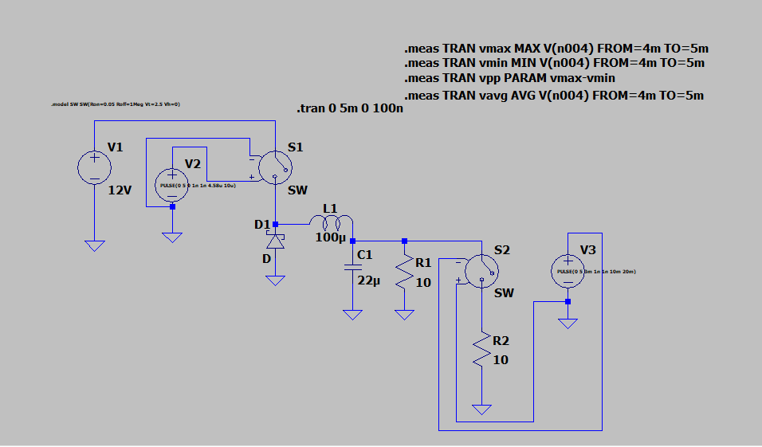
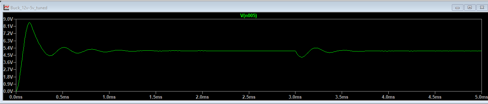
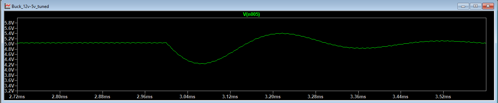

# 12 V to 5 V Buck Converter (Hand Design and LTspice Simulation)

I designed a buck converter by hand calculation, built it in LTspice, and checked that the simulation matches the math. This project is a simulation only. No board was built.

## Goal

| Item | Value |
|---|---|
| Input voltage | 12 V |
| Output voltage | 5 V |
| Load current | 1 A (5 ohm load) |
| Switching frequency | 100 kHz |
| Inductor current ripple (my choice) | 30% of 1 A = 0.3 A |
| Output voltage ripple goal | 50 mV or less |

I chose 30% inductor ripple as a balance. A smaller ripple needs a bigger inductor. A larger ripple makes the current drop to zero at light loads.

## Hand Calculations

1. **Duty cycle:** D = Vout / Vin = 5 / 12 = 0.4167
2. **Inductor:** L = (Vin minus Vout) x D / (delta I x fs) = 7 x 0.4167 / (0.3 x 100,000) = 97.2 uH. I used a standard **100 uH** part.
3. **Actual inductor ripple with 100 uH:** 0.292 A. The inductor current swings from about 0.854 A to 1.146 A.
4. **Light load limit:** the converter stays in continuous conduction until the load current drops below about 0.146 A.
5. **Output capacitor:** C = delta I / (8 x fs x delta V). For 50 mV ripple the minimum is 7.3 uF. I used **22 uF** for margin.
6. **Predicted output ripple with 22 uF:** 0.292 / (8 x 100,000 x 0.000022) = **16.6 mV**

## Simulation Setup (LTspice)

- 12 V source, voltage controlled switch (Ron 0.05 ohm, Roff 1 Mohm, turns on above 2.5 V), default Schottky diode from the LTspice library, 100 uH inductor, 22 uF capacitor.
- The switch is driven by a pulse source (0 V to 5 V, 10 us period). The pulse width sets the duty cycle.
- Open loop design. There is no feedback controller.
- The inductor and capacitor are ideal (no series resistance).
- Transient simulation for 5 ms.

## Results

### 1. First run with the ideal duty cycle (D = 0.4167)

| Measurement | Result |
|---|---|
| Average output voltage | 4.497 V |

The output is about 10% below the 5 V goal. The formula D = Vout / Vin assumes a perfect switch and diode. In the simulation the switch and diode drop voltage, so the average is lower.

### 2. Tuned duty cycle (on time 4.58 us, D = 0.458)

| Measurement | Result |
|---|---|
| Average output voltage (1 A load) | 5.021 V |
| Output ripple (peak to peak) | 19 mV (hand calculation predicted 16.6 mV) |

The simulation and the hand calculation agree within about 2 mV.

### 3. Load step (0.5 A to 1 A at 3 ms)

| Measurement | Result |
|---|---|
| Output before the step (0.5 A) | 5.044 V |
| Lowest output after the step | 4.236 V (dip of 0.81 V) |
| Highest output after the step | 5.413 V |
| Settled output after the step (1 A) | 5.021 V (overshoot of 0.39 V) |
| Settling time | about 0.4 ms (read from the plot by eye) |

### 4. Efficiency

| Load | Output power | Input power | Efficiency |
|---|---|---|---|
| 0.5 A (10 ohm) | 2.54 W | 2.77 W | 91.7% |
| 1.0 A (5 ohm) | 5.043 W | 5.507 W | 91.6% |

## Limits of This Design

- **Efficiency is optimistic.** The simulation includes switch resistance and diode drop. It does not include switching losses, gate drive losses, or inductor and capacitor resistance. A real converter would be less efficient.
- **No regulation.** With a fixed duty cycle, the output drops about 0.8 V when the load doubles. A feedback loop would reduce this.
- **No soft start.** The output overshoots to about 8.6 V at startup in the 10 ohm case.
- **Not done yet:** line step test (input voltage change) and efficiency at light load (below 0.5 A).

## What I Would Do Next

1. Add a feedback loop (a controller IC or a compensated error amplifier) and repeat the load step test.
2. Run a line step test.
3. Add real component resistances (inductor DCR, capacitor ESR) and check how ripple and efficiency change.
4. Build it on a board and compare to the simulation.

## What I Learned

- How duty cycle sets the output voltage, and why real switches and diodes shift it.
- How the inductor ripple choice drives the inductor size.
- Why the output capacitor determines voltage ripple.
- That an open loop converter dips and rings when the load changes.
